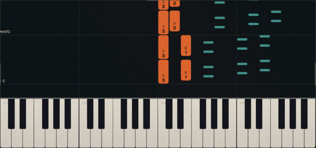

# midi2brain

A free piano trainer that runs in your browser. Learn chords, inversions, scales and songs with a MIDI keyboard, your microphone or your computer keyboard.

Try it now at midi2brain.com (https://midi2brain.com)

## What it does

- **Chords**: an adaptive chord trainer with inversions, progressions, musical keys and ear training. It practises the chords you find hardest more often.
- **Scales**: scale practice with fingering, for either hand or both.
- **Songs**: falling notes with automatic fingering, wait / play / listen / free modes, loops, a tempo control, a metronome and a score for every take.
- **Routine**: pick up to 3 songs and a session length (15 to 60 minutes) and it builds a practice plan. You warm up on the songs' scales and chords, then work on your weak bars hand by hand and speed them up step by step.
- **Chord detector and theory**: names whatever you play, and explains the theory behind it.

The app works with any MIDI keyboard (Web MIDI works in Chrome, Edge and Opera), with an acoustic piano through the microphone, or with just your computer keyboard.

## How the smart training works

midi2brain keeps track of what you know and spends your practice time on what you don't.

**Chords and scales.** With Smart practice on, every chord and scale in your selection has a score from 0 to 10. When you play it cleanly you gain up to 4 points depending on how quickly you found it; mistakes cost 1 to 4 points depending on how far off they were (a semitone slip or the right note in the wrong octave costs less than a wild miss) and on how many tries you needed. The next chord is picked at random, but low scores come up much more often, and a chord at 10 is retired until you've finished the whole set.

**Songs.** Every take is scored note by note: on time, early, late, missed or extra. In play mode your timing is measured against the clock; in wait and free mode it's measured against your own pulse, so you can play slowly as long as you're steady. The first note of a take only sets the pulse. Each bar keeps its own mastery, and the timing gets stricter as you master the bars you're playing, so a beginner isn't punished for wobbles that a confident player should fix.

**Routine.** You pick up to three songs and a session length, and the routine builds and runs a plan for you:

1. **Warm-up** on each song's scale and on the chord shapes each hand actually plays in the song, voiced as in the score. Shapes you've played cleanly several times are played from memory, without the keys lit up. A slip shows them again.
2. **A first run** through the song to find your weak bars. Those bars are grouped into short parts, sized by how much is going on in them (notes, chords, leaps).
3. **Each part in stages**: each hand alone, then hands together, then a tempo ladder in small steps, then the part in its context. Timing counts a little more at every stage. Until you've played every bar with the right notes, the routine works on notes only and leaves speed for later. Parts that repeat music you've already learned are skipped.
4. **Smart fixes.** Every mistake is classified (a chord change, a leap, a chord, a neighbouring key, a hesitation, or timing), and a mistake that keeps coming back gets a remedy that fits it: a short drill of that chord change in the Chords tab, a slower pass of the jump with one hand, one hand alone to settle the fingering, or a pass with the clock to steady the pulse.
5. **No getting stuck.** After three failed passes in a row a part is set aside and saved for your next session. When time runs out the part you're on is finished first; if you finish early, the songs come round again from where you left off.

All of this is stored in your browser, so the next session picks up where the last one stopped.

## Songs

The public version includes public-domain pieces only:

- Christian Petzold: Minuet in G (from the Notebook for Anna Magdalena Bach)
- Robert Schumann: The Happy Farmer
- J. S. Bach: Prelude in C major
- Ludwig van Beethoven: Für Elise
- Erik Satie: Gnossienne No. 1
- Frédéric Chopin: Waltz in A minor
- Ludwig van Beethoven: Moonlight Sonata, 1st movement
- Claude Debussy: Clair de lune

## Running it locally

There is no build step. Download or clone the repository and open `index.html` in your browser. The microphone and MIDI work best when the folder is served over `http://localhost`, for example with `python -m http.server`.

## Adding a song

Songs are plain JS files in `songs/`, written in a compact bar notation (the syntax is described at the top of `js/songformat.js`). `CLAUDE.md` explains how songs are read from sheet music PDFs with the scripts in `tools/`. Only pieces that are in the public domain can be added.

## Licence

midi2brain is **source-available** under the [PolyForm Noncommercial License 1.0.0](LICENSE.md). You're free to use, study, change and share it for any non-commercial purpose: learning, teaching, personal projects or research. Commercial use needs a separate licence. For that, please contact [feedback@midi2brain.com](mailto:feedback@midi2brain.com).

### Credits

The piano sound is the [Salamander Grand Piano V3](https://archive.org/details/SalamanderGrandPianoV3) by Alexander Holm, licensed under [CC BY 3.0](https://creativecommons.org/licenses/by/3.0/). It was taken from the MP3s of [Tone.js's Piano](https://github.com/tambien/Piano) and shortened (see `samples/piano/README.md`).
